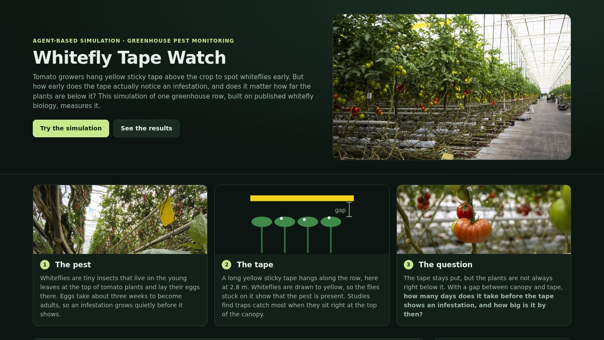
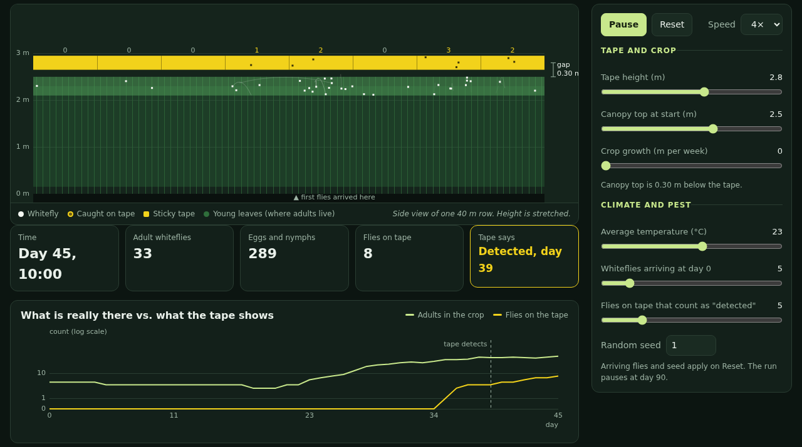
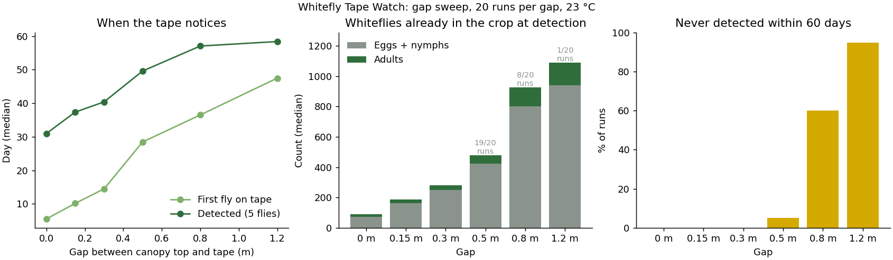

# Whitefly Tape Watch: an agent-based simulation

[](https://github.com/NadaAbbas444/whitefly-agent-based-sim/actions/workflows/test.yml)
[](https://github.com/NadaAbbas444/whitefly-agent-based-sim/actions/workflows/pages.yml)
[](https://nadaabbas444.github.io/whitefly-agent-based-sim/)


[](LICENSE)

**When does a yellow sticky tape notice a whitefly infestation, and does it matter how far below the tape the plants are?**

An agent-based simulation of one tomato greenhouse row, built on published whitefly biology. The model and experiments are written in **Python**; an interactive **browser demo** mirrors the same model and is tested to give identical numbers.

**[▶ Try the live demo](https://nadaabbas444.github.io/whitefly-agent-based-sim/)**



> **Key findings** (model results, 20 runs per setting)
> - Every **15–30 cm of gap** between the plant tops and the tape costs **about a week** of warning.
> - The tape always reports late: at detection, **eggs and young whiteflies outnumber adults about 4 to 1**.
> - With a gap of **0.8 m or more**, the tape **misses the infestation in most runs** within 60 days.

## The question

Whiteflies are tiny insects that live on the young leaves at the top of tomato plants. They lay their eggs there, and eggs take about three weeks to become adults, so an infestation grows quietly before it shows.

Growers hang **long yellow sticky tape above the crop** along the rows. In the commercial tomato greenhouse in Austria where I deployed drones, it hangs at about **2.8 m**. Whiteflies are drawn to yellow, so the flies stuck on the tape show that the pest is there.

The tape is fixed, but the plants are not always right below it. Studies show traps catch the most when they sit **at the top of the canopy**, and clearly fewer 30 cm above it. So:

> **With a gap between the canopy top and the tape, how many days does it take before the tape shows an infestation, and how big is the infestation by then?**

## The simulation



A side view of one 40 m row. Each white dot is one adult whitefly in the young-leaf layer. When a fly ends up on the tape, it is counted in one of eight tape segments, the way a camera would read the tape piece by piece. The chart compares **what is really in the crop** with **what the tape shows**.

You can change the tape height, the canopy height, crop growth, temperature, how many whiteflies arrive, and how many flies on the tape count as "detected".

## Results

Five adult whiteflies arrive at one spot on day 0, at 23 °C. Each gap was run 20 times for 60 days (`python3 scripts/experiment.py`). The table shows medians; "detected" means 5 flies on the tape.



| Gap (canopy top to tape) | First fly on tape | Detected | Adults at detection | Eggs + nymphs at detection | Never detected in 60 days | Fewer adults than without tape |
|---|---:|---:|---:|---:|---:|---:|
| 0 m | day 6 | day 31 | 18 | 71 | 0% | 47% |
| 0.15 m | day 10 | day 37 | 23 | 163 | 0% | 34% |
| 0.3 m | day 14 | day 40 | 33 | 249 | 0% | 25% |
| 0.5 m | day 28 | day 50 | 54 | 424 | 5% | 11% |
| 0.8 m | day 37 | day 57 | 125 | 802 | 60% | 2% |
| 1.2 m | day 47 | day 58 | 149 | 942 | 95% | 0% |

**What this suggests**
- **Every 15–30 cm of gap costs about a week of warning.** With the tape at the canopy top, it detects the infestation around day 31. At 0.5 m it takes until day 50, and at 0.8 m it misses the infestation in most runs.
- **The tape always reports late.** Even in the best case it fires after the first new generation has emerged, when **the eggs and nymphs already on the leaves outnumber the adults about 4 to 1**. With a 0.5 m gap, more than 400 young whiteflies are already hidden in the crop.
- **The first fly on the tape is an early warning worth acting on.** It comes weeks before the "5 flies" threshold, but it is a single noisy event.
- **The tape also reduces the population a little,** but only when it sits close to the canopy (about half when touching it, almost nothing beyond 0.5 m). That fits studies concluding yellow traps are more useful for monitoring than for control.
- **In a cooler greenhouse (18 °C) everything shifts later**, because whiteflies fly less: detection moves to about day 43 with no gap, and at 0.8 m the tape never detects within 60 days.

**Practical takeaway:** keep the tape close to the top of the canopy, and raise it, or lower the crop, as the plants change height.

These numbers come from a model with several assumed values (listed below). They show the *size and direction* of the effect, not exact days for a real greenhouse.

## How the model works

Every adult whitefly is an independent agent. Eggs and nymphs are tracked as a queue that turns into adults after the development time.

| Part | Rule | Basis |
|---|---|---|
| Where adults live | In the top 40 cm of the canopy (young leaves) | Whitefly biology: adults gather on young leaves |
| Life cycle | Egg to adult in 23 ± 3 days; female lives ~37 days; 90 eggs per female; 50% female | De Vis & van Lenteren 2002 (tomato); age-stage life tables at 25 °C |
| Immature survival | 50% of eggs become adults | **Assumption** |
| Flight timing | No flight at night; peak in the morning | Liu et al. 1994 |
| Temperature | No flight below 16.5 °C, full activity from 25 °C | Liu et al. 1994 (threshold 16–17 °C); upper value is an **assumption** |
| Flight distance | Mostly short hops (mean 0.3 m), 10% longer flights (mean 3 m) | Bonsignore 2015 (a few cm to over 2–3 m); exact mix is an **assumption** |
| Flights per day | 4 per adult at full activity | **Assumption** |
| Tape catch | Each flight has a 1% chance to end on the tape when the tape touches the canopy top; this drops by a factor e for every 30 cm of gap | Trap-height studies show clearly fewer catches 30 cm above canopy; the 1% is an **assumption** |
| Crop past the tape | If the plants grow above the tape, leaves hide it and catches drop fast | **Assumption** |
| Infestation start | 5 adults arrive at one random spot in the row | Scenario choice |

**Engineering notes**
- **Python is the reference model** (`whitefly/sim.py`, standard library only). The experiment script and the results figure use it.
- **The browser demo (`src/sim.js`) is a line-by-line mirror** so the simulation can run live on a web page. Both use the same 32-bit seeded random number generator (mulberry32), so the same seed gives the same run in both languages. `tests/test_cross_check.py` runs the JavaScript version and checks that every daily count, every tape segment and every experiment result is **identical** to Python.
- The model is **deterministic**: same seed, same result, which makes every number in this README reproducible.
- The full 140-run sweep takes about 10 seconds in Python and under a second in the browser.
- 22 pytest tests (model behaviour + cross-check) and 13 JavaScript tests run in GitHub Actions on every push, together with ruff linting and format checks.

## Sources

- Liu et al. 1994, *Journal of Entomological Science*: traps 5 cm above the canopy catch more than higher ones; morning flight peak, little flight in the dark; flight starts at 16–17 °C. (Values taken from the abstract.)
- Gillespie, *The Canadian Entomologist*: [flight behaviour of the greenhouse whitefly in relation to yellow sticky traps](https://resolve.cambridge.org/core/journals/canadian-entomologist/article/flight-behavior-of-the-greenhouse-whitefly-trialeurodes-vaporariorum-westwood-homoptera-aleyrodidae-in-relation-to-yellow-sticky-traps1/3CBE1FBE161EE15949EDAD0632FA8FCC).
- Trap height in greenhouse cucumber, traps at canopy top vs. 30 cm above and below: [SFU thesis](https://summit.sfu.ca/_flysystem/fedora/sfu_migrate/6038/b15324175.pdf).
- Upper traps catch more greenhouse whitefly in tomato: [Korean tomato study](https://www.koreascience.or.kr/article/JAKO201209857779036.pdf).
- Hang traps just above the canopy and raise them as the crop grows: [UConn sticky card fact sheet](https://ipm.cahnr.uconn.edu/wp-content/uploads/sites/3216/2022/12/2019stickycardsfactsheet-1.pdf).
- Flight types and distances: Bonsignore 2015, [*Entomological Science*](https://zendy.io/title/10.1111/ens.12097).
- Life history on tomato: [De Vis & van Lenteren 2002, *Bulletin of Insectology*](https://archive.bulletinofinsectology.org/pdfarticles/vol55-2002-003-008devis.pdf).
- Development and temperature: [CIP pest risk atlas](https://cipotato.org/riskatlasforafrica?p=882).
- Yellow traps more useful for monitoring than mass trapping in tomato: [1987 study, *Applied Entomology and Zoology*](https://www.jstage.jst.go.jp/article/aez1966/22/2/22_2_159/_article/-char/en).

## Limitations

- **Development time does not depend on temperature** in this version. Only flight does. Real whiteflies develop faster in warmer conditions, so warm-greenhouse populations would grow faster than shown.
- **Several values are assumptions** (marked above), especially the per-flight catch chance and flights per day. Real tape counts from greenhouse monitoring could calibrate them.
- The model is a 2-D side view of a single row; neighbouring rows, height differences along the row and plant damage are left out.
- No biological control (for example the parasitic wasp *Encarsia formosa*) and no spraying.

## Run it locally

The model needs only Python 3.10+. Tests and the figure need pytest and matplotlib; the cross-check also uses Node.js 18+ if it is installed.

```bash
pip install -r requirements-dev.txt
```

```bash
python3 scripts/experiment.py                                # gap sweep, prints the results table
python3 scripts/experiment.py --temp 18                      # cooler greenhouse
python3 scripts/experiment.py --plot docs/results-plot.png   # also save the figure
pytest                                                       # 22 tests, incl. Python vs. browser cross-check
```

```bash
npm run serve   # browser demo at http://localhost:8080
```

```bash
npm test        # 13 JavaScript tests
```

Shareable links: `?gap=0.5`, `?seed=3`, `?speed=8`, `?warmup=40` (open on day 40), `?runexp` (run the experiment on load).

## Project structure

```
whitefly/sim.py               reference model (agents, life cycle, flight, tape)
whitefly/experiment.py        gap sweep and summary statistics
scripts/experiment.py         command-line experiment, prints the results table
scripts/plot_results.py       results figure (matplotlib)
tests/test_sim.py             model tests (pytest)
tests/test_cross_check.py     browser demo must match Python exactly

index.html, styles.css        browser demo page
src/sim.js, src/experiment.js JavaScript mirror of the model
src/app.js, src/chart.js      side-view rendering, controls, charts
scripts/export_reference.mjs  exports JavaScript results for the cross-check
tests/sim.test.js             JavaScript tests (node:test)

pyproject.toml                packaging, pytest and ruff config
CITATION.cff                  how to cite
```

## What's next

- Make development time depend on temperature.
- Calibrate the catch model against real tape counts.
- Compare tape layouts: one tape vs. two per row, or a lower second tape between the plants.

## Citation

If you use or build on this model, please cite it using [`CITATION.cff`](CITATION.cff) (GitHub shows a "Cite this repository" button).

## License

Code: [MIT](LICENSE), © 2026 Nada Fahim. The greenhouse photos in `assets/` are not covered by the MIT license and may not be reused.
